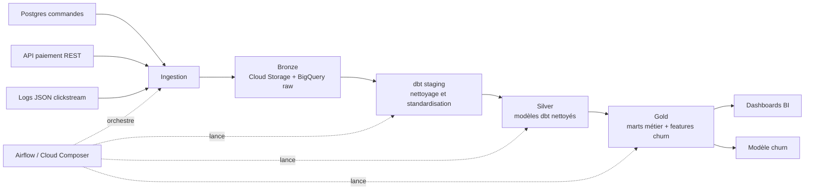

# Plateforme data (projet fil rouge)

## 1. Objectif

Chaque nuit, ingérer les changements de commandes depuis Postgres, les transactions de paiement depuis l’API REST du prestataire et les logs applicatifs JSON de clickstream depuis Cloud Storage dans BigQuery, transformer ces données avec dbt, exécuter des tests de qualité, et rendre les dashboards ainsi que la table de features churn disponibles avant 7h pour moins de 500 € par mois.

## 2. Périmètre

**Inclus** :

- Ingestion incrémentale des changements de commandes Postgres, avec un volume d’environ 20 Go par jour.
- Ingestion de l’API REST du prestataire de paiement en tenant compte des quotas et des corrections a posteriori.
- Ingestion des logs JSON de clickstream, avec gestion de l’évolution du schéma.
- Transformation des données avec dbt dans BigQuery selon les couches staging, silver et gold.
- Production de dashboards métier et d’une table quotidienne de features pour le modèle de churn.
- Conservation de 3 ans d’historique et prise en charge des demandes de suppression RGPD.
- Orchestration et supervision des traitements avec Airflow / Cloud Composer.

**Exclu** :

- Prédiction de churn en temps réel.
- Réentraînement automatique et déploiement du modèle de machine learning.
- Détection de fraude en temps réel.
- Réconciliation comptable complète avec tous les systèmes financiers.
- Architecture multi-région active/active.
- Self-service data mesh pour l’ensemble des équipes.
- Remplacement des systèmes opérationnels Postgres ou du prestataire de paiement.

## 3. Critères de réussite

- Les tables gold utilisées par les dashboards sont disponibles avant 7h chaque matin.
- La table quotidienne de features churn est produite avant 7h.
- Le pipeline atteint un taux de succès d’au moins 95 % sur une période glissante de 30 jours.
- Les données de commandes sont ingérées de manière incrémentale sans retraitement complet quotidien.
- Les données corrigées du prestataire de paiement sont répercutées lors des rejouements.
- Les tests dbt bloquants vérifient au minimum les clés uniques, les colonnes obligatoires, les valeurs acceptées et les relations entre modèles.
- Les demandes de suppression RGPD sont exécutées dans un délai maximal de 72 heures.
- Les données disponibles couvrent 3 ans d’historique.
- Le budget cloud mensuel reste inférieur à 500 €.
- Des alertes de facturation sont configurées à 50 %, 90 % et 100 % du budget mensuel.

## 4. Hypothèses

- Les changements Postgres peuvent être extraits avec une colonne de modification, un mécanisme CDC ou une fenêtre de reprise.
- L’API de paiement possède un mécanisme de pagination et permet de relire une période historique.
- Les données de paiement peuvent être corrigées après leur première récupération.
- Les logs clickstream sont déposés quotidiennement au format JSON dans Cloud Storage.
- Le schéma des logs peut évoluer sans rendre toutes les colonnes historiques invalides.
- Une exécution batch nocturne est suffisante pour répondre à l’objectif de disponibilité avant 7h.
- BigQuery est utilisé comme entrepôt analytique pour les couches bronze, silver et gold.
- dbt est utilisé pour les transformations, les tests, la documentation et le lineage analytique.
- Airflow / Cloud Composer orchestre les extractions, les chargements, les commandes dbt et les contrôles.
- La tranche du projet privilégie des services managés afin de limiter l’exploitation d’infrastructure.

## 5. Architecture



### Responsabilités des couches

- **Bronze** : conserver les données proches de la source, avec les métadonnées d’ingestion et la date logique de traitement.
- **dbt staging** : renommer les colonnes, convertir les types, normaliser les formats et préparer les sources.
- **Silver** : dédupliquer, appliquer les règles de qualité et construire les entités fiables comme les commandes, les clients et les paiements.
- **Gold** : construire les indicateurs métier, les agrégats pour les dashboards et les features quotidiennes du modèle de churn.
- **Usage** : fournir les tables gold aux outils BI et à l’équipe data science.

## 6. Démarrage

```bash
make setup   # environnement, dépendances, hooks pre-commit
make test    # tests Python et tests du projet
make data    # génère des données synthétiques dans data/raw/
make dbt-deps # installe les dépendances dbt
make dbt-run  # construit les modèles dbt
make dbt-test # exécute les tests dbt
```

## 7. Exemple de workflow quotidien

```text
01. Extraire les changements Postgres
02. Récupérer la fenêtre de paiements auprès de l’API
03. Charger les fichiers clickstream dans la zone brute
04. Charger les données dans les tables bronze
05. Exécuter les modèles dbt staging
06. Exécuter les modèles dbt silver
07. Exécuter les tests dbt bloquants
08. Construire les modèles gold
09. Construire la table de features churn
10. Exécuter les contrôles finaux
11. Publier les données pour les dashboards avant 7h
```

## 8. Décisions

Voir `docs/adr/`.

- `docs/adr/001-cloud-et-entrepot.md`
- `docs/adr/002-idempotence-et-backfill.md`
- `docs/adr/003-transformations-avec-dbt.md`